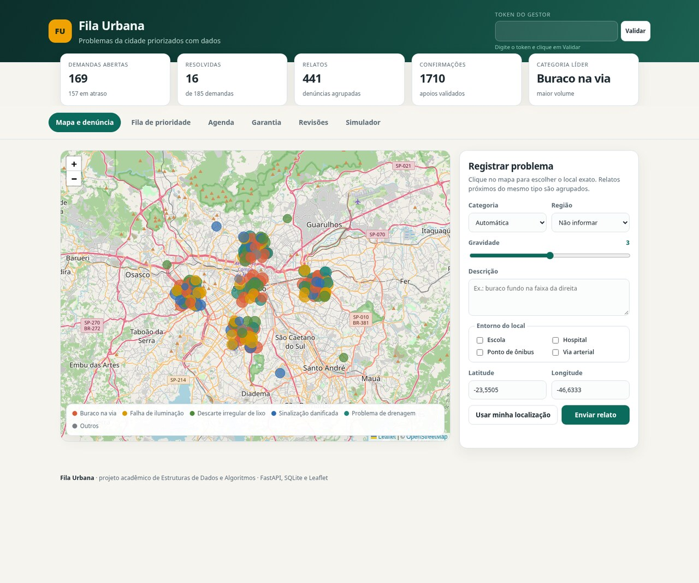

# Fila Urbana

Mapa colaborativo de problemas urbanos com fila de prioridade.

- **Site:** [fila-urbana.onrender.com](https://fila-urbana.onrender.com)
- **Documentação:** [fila-urbana.onrender.com/docs](https://fila-urbana.onrender.com/docs)
- **Testes:** 76 passando
- **Projeto:** Estruturas de Dados e Algoritmos



O Fila Urbana é um projeto acadêmico. A ideia é simples: o cidadão aponta um problema no mapa e o sistema organiza o que deve ser resolvido primeiro. Por baixo, usa Python, FastAPI, SQLite, Leaflet e JavaScript puro, sem Node, React, ORM ou Docker.

## Resumo

Pense no sistema como um mapa da cidade com uma lista de tarefas que se organiza sozinha. Cada problema recebe uma nota de urgência. Os mais graves, antigos ou confirmados por mais gente sobem na fila. O gestor vê essa fila, acompanha prazos e atualiza o andamento.

## Funcionamento

1. **Registro.** A pessoa abre o site, marca o local no mapa, escolhe a categoria, a gravidade e os arredores, e escreve uma descrição. Não precisa de cadastro.
2. **Agrupamento.** Se já existe um problema do mesmo tipo em até 50 metros e nos últimos 30 dias, o novo relato é somado ao existente. Assim, vinte buracos iguais viram um problema com vinte relatos, em vez de vinte problemas separados.
3. **Classificação.** O sistema lê palavras-chave da descrição e tenta descobrir a categoria. Ele mostra o grau de confiança; quando fica em dúvida, o caso vai para a fila de revisão.
4. **Nota.** Cada problema ganha uma nota de 0 a 100. A conta considera gravidade, risco do entorno, tempo em aberto, confirmações, recorrência e a prioridade da categoria.
5. **Fila.** O gestor vê os problemas mais urgentes primeiro, com prazo, mapa, relatos e histórico. Pode marcar como em análise, em execução ou resolvido.
6. **Acompanhamento.** A agenda mostra o que está atrasado ou perto do prazo. A aba de garantia destaca os casos muito acima do prazo. A população também pode confirmar problemas existentes.

## Recursos

- Registrar problemas anonimamente pelo mapa.
- Juntar relatos parecidos e evitar duplicidade.
- Classificar o texto e revisar os casos duvidosos.
- Consultar a fila por prioridade e por região.
- Acompanhar prazos, atrasos e garantia de atendimento.
- Confirmar problemas existentes.
- Ver o detalhe de cada demanda, com a nota e o histórico.
- Simular outros critérios e ver o Top 10 recalculado.
- Usar no celular ou no computador, sem instalar nada.

## Tecnologias

| Camada | Ferramenta |
|---|---|
| Backend | Python, FastAPI e Uvicorn |
| Banco | SQLite, sem ORM |
| Frontend | HTML, CSS e JavaScript puro |
| Mapa | Leaflet e OpenStreetMap |
| Testes | pytest |
| Deploy | Render, plano free |

Fora da stack: Node, React, ORM, Docker, Redis e banco externo.

## Dados

- O banco é um arquivo SQLite com tabelas para demandas, relatos, confirmações, eventos e histórico da nota.
- O agrupamento usa uma grade de coordenadas e confere a distância real com a fórmula de haversine. O raio é de 50 metros e a janela é de 30 dias.
- Uma confirmação vale para uma demanda por dispositivo por dia, em um raio de 200 metros. Cada demanda aceita até 20 confirmações.
- O seed é determinístico e cria 185 demandas, 441 relatos e 1.710 confirmações para demonstração.
- Não há login, foto, IP armazenado ou identificação civil. As coordenadas retornadas pela API são arredondadas.

## Prioridade

A nota é calculada assim:

```text
nota = 100 × soma(peso × componente)
```

| Componente | Peso |
|---|---:|
| Gravidade | 30% |
| Risco | 20% |
| Tempo | 20% |
| Confirmações | 15% |
| Recorrência | 10% |
| Categoria | 5% |

Prazos por categoria: buraco 7 dias, iluminação 5, lixo 3, sinalização 10, drenagem 5 e outros 15.

Os pesos são normalizados para somar 1. O desempate é: maior nota, menor prazo e menor identificador. A nota é recalculada na leitura, então a fila não fica presa a um valor antigo.

## Estruturas

- **Heap binário máximo:** mantém a fila de prioridade e o Top 10 do simulador. Foi implementado à mão, sem biblioteca pronta.
- **Ordenação por intercalação:** ordena a agenda e a garantia.
- **Busca binária:** encontra o corte de datas na agenda.
- **Fila FIFO:** organiza os relatos que precisam de revisão, usando `deque`.
- **Dicionários:** guardam categorias, palavras-chave, pesos, riscos e transições.
- **Índices SQLite:** aceleram as buscas por célula, status, região e relacionamentos.

## Execução

```bash
git clone https://github.com/eduu2x/fila_urbana.git
cd fila_urbana
python3 -m venv .venv
source .venv/bin/activate
pip install -r requirements.txt
export FILA_URBANA_TOKEN_GESTOR=escolha-um-token
python scripts/semear.py --limpar
uvicorn app.main:app --reload --workers 1
```

Acesse `http://127.0.0.1:8000`. A documentação interativa fica em `/docs`.

Para rodar os testes:

```bash
pip install -r requirements-dev.txt
pytest
```

## Testes

A suíte tem 76 testes:

- Estruturas: heap, FIFO, ordenação por intercalação e busca binária.
- Classificação: palavras-chave, acentos, confiança e caso sem categoria.
- Prioridade: pesos, fórmulas, saturações e efeito dos componentes.
- Utilidades: datas, distância, células e normalização de texto.
- Serviços: desempate da fila.
- API: saúde, categorias, criação, agrupamento, confirmações, autorização, verificação do token, status, filtros, top, mapa, agenda, garantia, estatísticas, revisões, simulação, arquivos estáticos e favicon.

Cada teste de API usa um banco temporário isolado. O seed não roda nos testes.

## API

Base: `/api`.

| Método | Rota | Descrição |
|---|---|---|
| `GET` | `/api/saude` | Saúde e versão |
| `POST` | `/api/gestor/verificar` | Valida o token do gestor |
| `GET` | `/api/categorias` | Categorias, prazos e pesos |
| `POST` | `/api/relatos` | Cria um relato ou soma a uma demanda próxima |
| `GET` | `/api/demandas` | Lista com filtros |
| `GET` | `/api/demandas/top` | Fila priorizada |
| `GET` | `/api/demandas/{id}` | Detalhe da demanda |
| `PATCH` | `/api/demandas/{id}/status` | Atualiza o status; exige token |
| `GET` | `/api/agenda` | Atrasadas e vencimentos |
| `GET` | `/api/garantia` | Casos acima de 2× o prazo |
| `GET` | `/api/revisoes` | Fila de revisão |
| `POST` | `/api/simulacao` | Recalcula o Top 10 sem gravar |

Erros de validação retornam `422`; regra de negócio, `400`; não encontrado, `404`; token inválido, `401`; conflito de confirmação, `409`.

## Token

O token é uma senha simples da equipe, não um login. Ele libera as ações de gestão, como mudar o status de uma demanda e concluir uma revisão. O cidadão não precisa dele para registrar ou confirmar problemas.

- No servidor, o token fica na variável `FILA_URBANA_TOKEN_GESTOR` e não tem valor padrão. Sem essa variável, as ações de gestão ficam bloqueadas.
- No site, o campo **Token do gestor** fica no topo. Digite o valor e clique em **Validar**; o site confirma na hora se o token é válido, sem alterar nenhum dado.
- No Render, o caminho é **serviço → Environment → FILA_URBANA_TOKEN_GESTOR → editar → salvar**. O `render.yaml` usa `sync: false`, então o segredo não fica no repositório e não é sobrescrito pelo Blueprint.
- Em uso real, use um valor forte e exclusivo da equipe. O token é uma simplificação acadêmica; um sistema público precisaria de login, perfis e auditoria.

## Deploy

O site está publicado no Render:

- URL: https://fila-urbana.onrender.com
- Health check: https://fila-urbana.onrender.com/api/saude
- Build: `pip install -r requirements.txt`
- Start: `uvicorn app.main:app --host 0.0.0.0 --port $PORT --workers 1`
- Variáveis: `FILA_URBANA_DB`, `AUTO_SEED=1` e `FILA_URBANA_TOKEN_GESTOR`

Se o auto-deploy estiver ligado, cada push na branch `main` publica uma nova versão. Também é possível usar **Manual Deploy → Deploy latest commit**. O plano free usa disco efêmero: o SQLite pode ser recriado a cada deploy, reinício ou spin-down. Com `AUTO_SEED=1`, um banco vazio é semeado novamente, o que serve para demonstração.

## Limitações

O projeto é um piloto de uma cidade, com base sintética. A classificação é lexical e explicável, não aprende sozinha. A fila é uma recomendação de prioridade, não uma decisão automática de política pública. Ficam fora do MVP: fotos, notificações, aplicativo nativo, autenticação institucional, integração com sistemas da prefeitura, múltiplas cidades e antifraude real.

## Decisões

- Stack mínima: FastAPI, SQLite e JavaScript puro, sem Node, ORM ou Docker.
- Heap derivado na leitura para evitar uma fila obsoleta; os snapshots ficam no histórico.
- Grade de coordenadas como índice grosseiro e haversine como confirmação exata dos 50 metros.
- Nota com componentes visíveis e pesos normalizados, em vez de um número opaco.
- Fila FIFO separada para revisar classificações de baixa confiança.
- Token simples de gestor e token local de cidadão, adequados ao escopo acadêmico.
- Seed determinístico para demonstração e testes reproduzíveis.
- Código sem comentários, com identificadores em português e testes como documentação executável.
